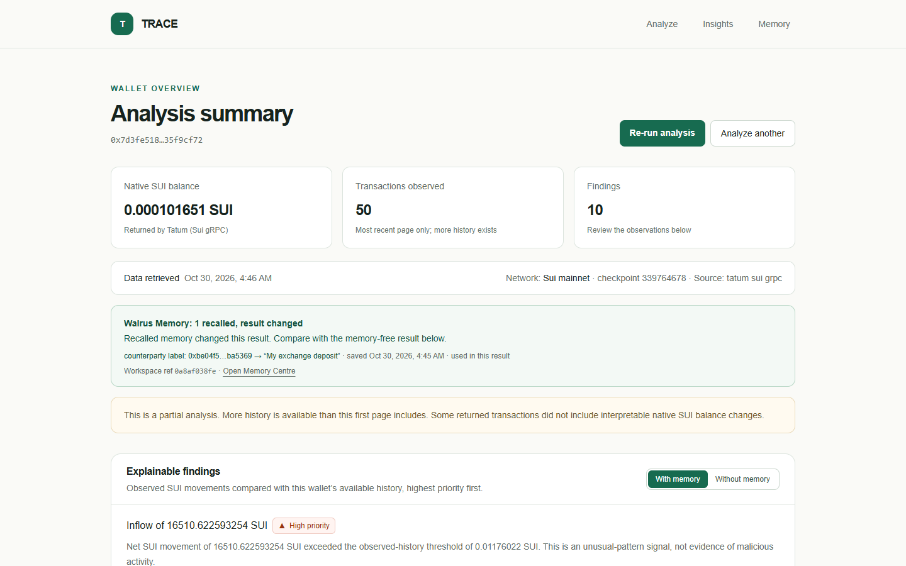
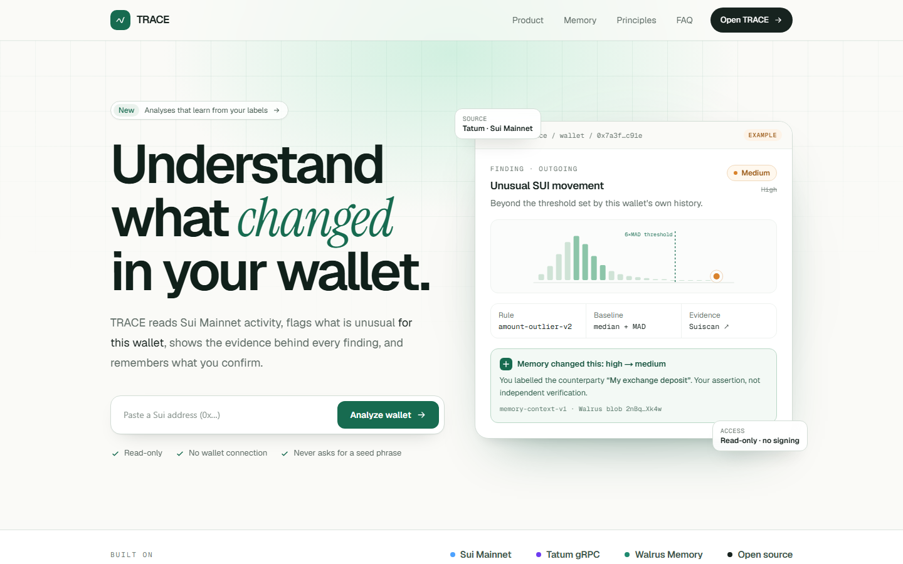
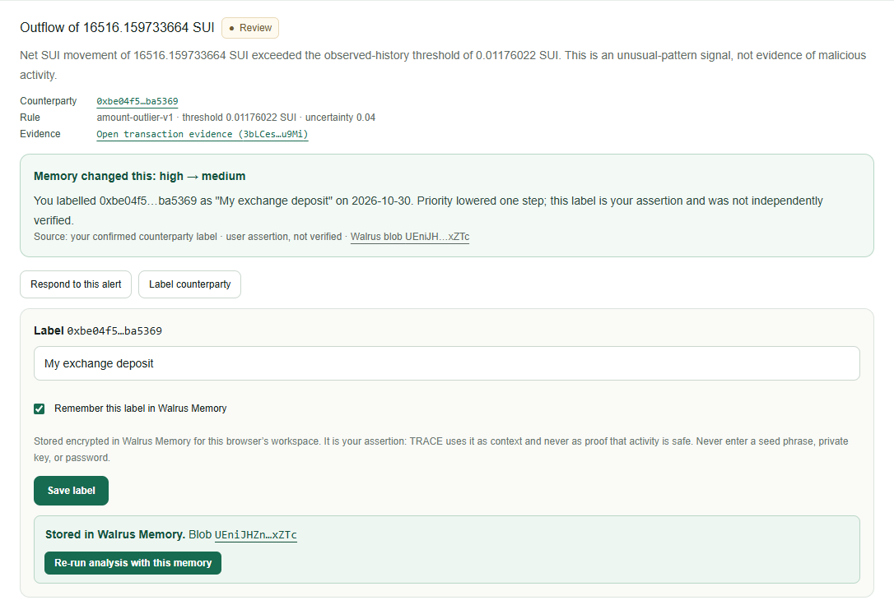
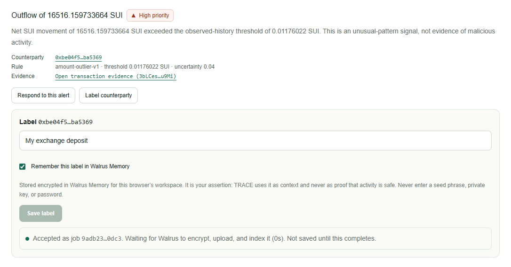
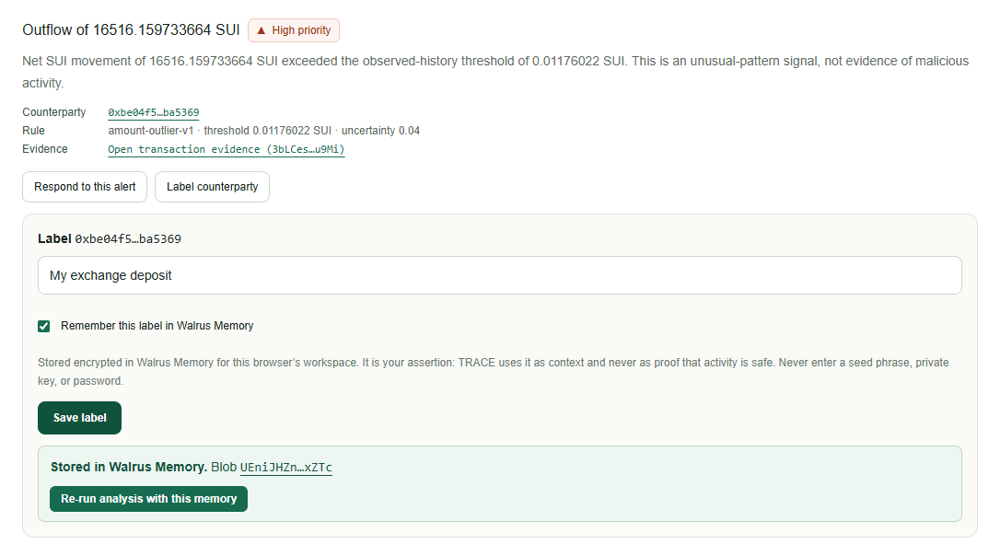
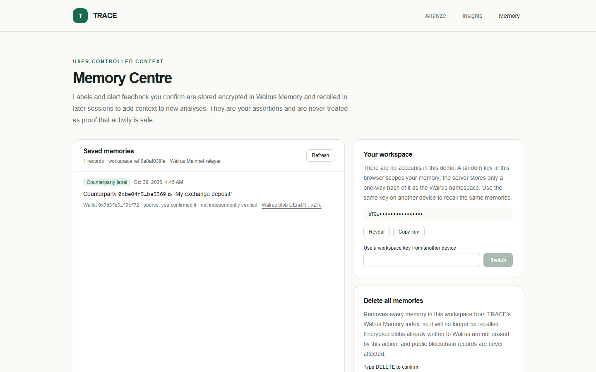
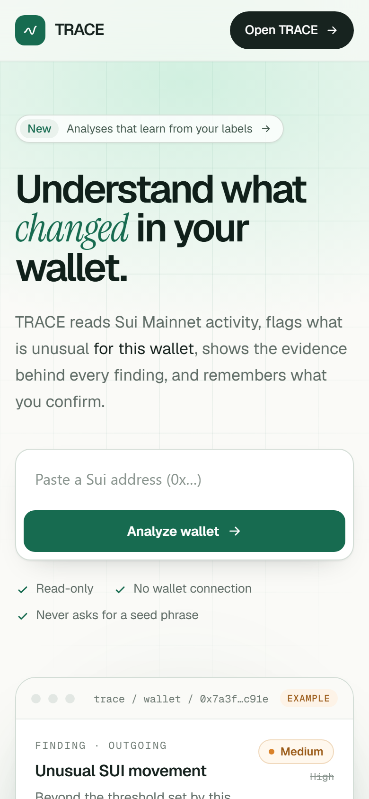
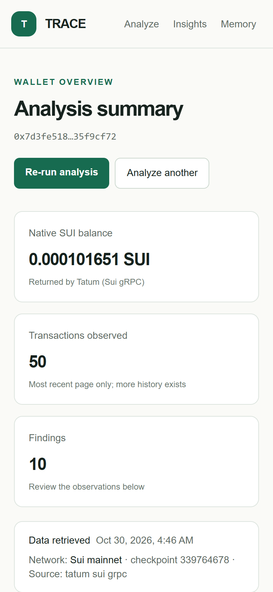
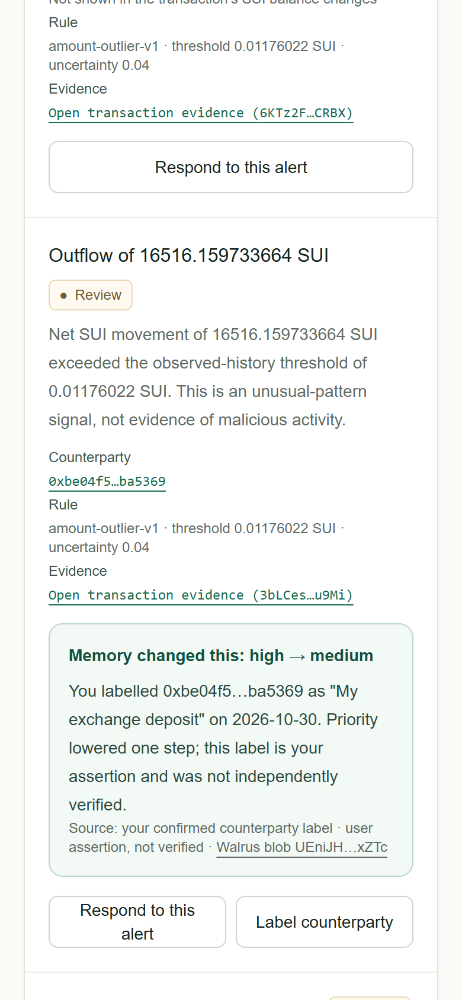
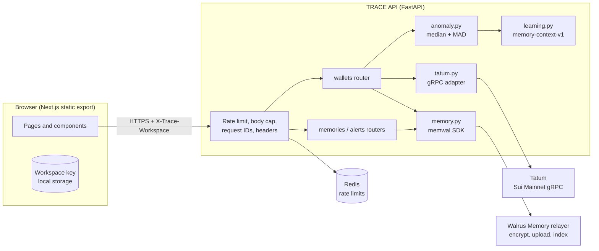

<div align="center">

# TRACE

**Sui wallet intelligence that remembers what you confirm.**

TRACE reads a wallet's recent Sui Mainnet activity through Tatum, flags statistically unusual movements with on-chain evidence, and learns from your labels and alert feedback through Walrus Memory. Later analyses change in ways you can see and verify.

[](https://trace-7w2.pages.dev/)
[](https://trace-ym2m.onrender.com/health)

**Live app:** [https://trace-7w2.pages.dev](https://trace-7w2.pages.dev/) &nbsp;|&nbsp; **Live API:** [https://trace-ym2m.onrender.com](https://trace-ym2m.onrender.com/health)

[](apps/api/requirements.txt)
[](apps/api)
[](apps/web)
[](apps/web/tsconfig.json)
[](https://sui.io)
[](https://docs.tatum.io/reference/rpc-sui)
[](https://docs.wal.app/walrus-memory/python-sdk/usage/memwal)

[](docs/TEST_REPORT.md)
[](docs/TEST_REPORT.md)
[](docs/TEST_REPORT.md)
[](#security-and-privacy)

[Features](#features) · [Screenshots](#screenshots) · [Architecture](#architecture) · [Quick start](#quick-start) · [Deployment](#deployment) · [Testing](#testing) · [Security](#security-and-privacy)

<a href="https://trace-7w2.pages.dev/"></a>

<sub>Click the screenshot to open the live app.</sub>

</div>

## Why TRACE

Wallet explorers show raw transactions. They don't tell you which ones are unusual for this wallet, and they forget that you already checked a transfer last week. TRACE does three things differently:

1. **Evidence before confidence.** Every finding links to the transaction on Suiscan and shows the rule, threshold, and uncertainty behind it. Findings say "unusual relative to this wallet's history", never "scam".
2. **Memory that changes behaviour.** Counterparty labels and alert feedback are stored encrypted in Walrus Memory. On the next analysis TRACE recalls them, adjusts priority, cites the exact memory (Walrus blob ID) that caused each change, and shows the memory-free result side by side.
3. **Honest boundaries.** Read-only, with no wallet connection or signing. Memory is your assertion, never proof of safety. If a provider is down, TRACE says so instead of guessing.

## Features

| Area | What it does |
|---|---|
| Wallet analysis | Validates the address, verifies the provider is on Sui Mainnet, and reads the native SUI balance and the 50 most recent transactions through Tatum's Sui gRPC interface. All amounts use exact decimal arithmetic. |
| Anomaly detection | Rule `amount-outlier-v2`: separate median + MAD baselines for incoming and outgoing transfers, with gas-only and failed transactions excluded and the sender's gas fee removed from transfer amounts. Severity comes from robust z-score bands (medium at 4, high at 12). Each finding carries a confidence score with the factors behind it, plus uncertainty, counterparty and evidence. Large amounts are never labelled malicious. |
| Learning loop | Label a counterparty or mark an alert expected, needing review, or incorrect. The write is confirmed only after the Walrus job completes. Re-analysis then shows "Memory changed this: high → medium" with provenance. |
| Compare | One toggle switches between the result with memory and the same chain facts without memory. |
| Memory Centre | Lists every saved memory with type, date, source, and Walrus blob. You can move your workspace to another device or delete everything after a confirmation that explains what deletion cannot erase. |
| Resilience | Retries with backoff and jitter, timeouts, response-size caps, and an honest stateless mode when memory is unreachable. A partial-history indicator shows when data is incomplete. |
| Production hardening | Startup configuration validation, a Redis-backed rate limiter that fails closed, structured JSON logs, readiness checks, a strict CSP and security headers, and a container image that runs as a non-root user. |
| Mobile | Layouts verified at 320, 360, 390, and 414 px with no horizontal scrolling and 44 px touch targets. Inputs use 16 px text so iOS doesn't zoom on focus. |

## Screenshots

<table>
  <tr>
    <td width="50%"><br><sub>Landing</sub></td>
    <td width="50%"><br><sub>A finding changed by recalled memory, citing the Walrus blob</sub></td>
  </tr>
  <tr>
    <td><br><sub>Write accepted. Not reported as saved until Walrus completes the job.</sub></td>
    <td><br><sub>Stored, with the Walrus blob ID</sub></td>
  </tr>
  <tr>
    <td colspan="2"><br><sub>Memory Centre</sub></td>
  </tr>
</table>

<p align="center">
  
  
  
</p>

## Architecture



Analysis flow:
1. Validate the address.
2. Fetch chain data and recall memory in parallel.
3. Normalize amounts with `Decimal`.
4. Compute the stateless findings.
5. Apply memory.
6. Return both results with full provenance.

Details: [docs/ARCHITECTURE.md](docs/ARCHITECTURE.md).

**How memory is isolated.** There are no user accounts. Each browser holds a random 192-bit workspace key. The API derives a Walrus namespace from its SHA-256 hash, so it never stores the key. Every read, job lookup, and delete is checked against the caller's namespace. Recalled text is re-validated against a strict schema, and anything that fails, including injected instructions or records claiming to be verified, is dropped.

## Tech stack

| Layer | Choice |
|---|---|
| Web | Next.js 16 (static export), React 18, TypeScript (strict), Tailwind CSS |
| API | Python 3.12, FastAPI, Pydantic v2, uvicorn |
| Chain data | Tatum Sui gRPC (`sui.rpc.v2`), with the schema vendored and refreshable |
| Memory | Walrus Memory via the official `memwal` Python SDK |
| Rate limiting | Redis-compatible store, atomic Lua counter |
| Quality | pytest (including SDK mock and live opt-in tests), pip-audit, npm audit, gitleaks, GitHub Actions |

## Quick start

Requirements: Python 3.11+, Node.js 20.9+, a Tatum API key, and (optionally) a Walrus Memory account and delegate key.

```bash
# API
cd apps/api
python -m venv .venv && . .venv/bin/activate      # Windows: .venv\Scripts\activate
pip install -r requirements-dev.txt
cp .env.example .env                               # then fill in the keys
TRACE_ENV=development uvicorn app.main:app --reload --port 8000

# Web (new terminal, repository root)
npm ci
echo "NEXT_PUBLIC_API_URL=http://localhost:8000" > apps/web/.env.local
npm run dev                                        # http://localhost:3000
```

Or run the API and Redis together with Docker:

```bash
docker compose up --build                          # API on http://localhost:8000
```

## Configuration

All secrets are server-side. The web build takes only `NEXT_PUBLIC_API_URL`.

| Variable | Required | Description |
|---|---|---|
| `TRACE_ENV` | yes | `development`, `demo`, or `production`. Production validates everything below at startup and refuses to boot if anything is missing or unsafe. |
| `TATUM_MAINNET_API_KEY` | yes | Tatum key (sent as `x-api-key` gRPC metadata) |
| `TATUM_GRPC_TARGET` | no | Defaults to `sui-mainnet-grpc.gateway.tatum.io:443` |
| `RATE_LIMIT_STORE` | no | `redis` (default, shared across instances) or `memory` (single-instance deployments, no Redis needed) |
| `REDIS_URL` | when store is `redis` | Shared rate-limit store. Production fails closed if it is missing or unreachable. |
| `BACKEND_CORS_ORIGINS` | production | Comma-separated public `https://` web origins |
| `ALLOWED_HOSTS` | production | API host names, comma separated. On Render the service's own host (`RENDER_EXTERNAL_HOSTNAME`) is trusted automatically, so list only custom domains. |
| `WALRUS_MEMORY_PRIVATE_KEY` | for memory | Walrus Memory delegate key (Ed25519) |
| `MEMWAL_ACCOUNT_ID` | for memory | Walrus Memory account object ID |
| `MEMWAL_SERVER_URL` | no | Defaults to `https://relayer.memory.walrus.xyz` |
| `MEMWAL_NAMESPACE_PREFIX` | production | For example `trace-prod`. Must differ from the development prefix. |
| `ANALYSIS_RATE_LIMIT` / `ANALYSIS_RATE_WINDOW_SECONDS` | no | Defaults to 10 requests per 60 s per client |
| `ENABLE_API_DOCS` | no | `false` by default in production, which hides `/docs` and `/openapi.json` |
| `LOG_FORMAT` | no | `auto` (JSON in production), `json`, or `text` |

## Deployment

**Production:**

| Component | Host | URL |
|---|---|---|
| Web app | Cloudflare Pages | [https://trace-7w2.pages.dev](https://trace-7w2.pages.dev/) |
| API | Render | [https://trace-ym2m.onrender.com](https://trace-ym2m.onrender.com/health) (`/health`, `/ready`) |

If the Render plan sleeps when idle, the first request after a quiet period can take up to a minute while the API wakes up.

**Deploy your own:**

| Component | Target | Configuration |
|---|---|---|
| API and Redis | Render (Blueprint) | [`render.yaml`](render.yaml) |
| API (any container host) | Docker | [`apps/api/Dockerfile`](apps/api/Dockerfile) |
| Web | Vercel, Cloudflare Pages, or Netlify | [`vercel.json`](vercel.json), [`apps/web/public/_headers`](apps/web/public/_headers), [`apps/web/netlify.toml`](apps/web/netlify.toml) |

1. Deploy the Render Blueprint. Set the secrets marked `sync: false` and set `BACKEND_CORS_ORIGINS` to your web origin.
2. Check `GET /ready`. It returns 200 with `"ready": true` once configuration and Redis are healthy, and 503 otherwise.
3. Deploy the web app with `NEXT_PUBLIC_API_URL=https://<your-api-host>`. If the API is not on `*.onrender.com`, add its origin to `connect-src` in the CSP.

The full checklist is in [infra/deployment/README.md](infra/deployment/README.md).

## Testing

```bash
cd apps/api
TRACE_ENV=development python -m pytest -q                       # 86 offline tests (1 live test skipped)
TRACE_ENV=development TRACE_LIVE_TESTS=1 python -m pytest -q    # adds a live Tatum Mainnet test
python scripts/memory_demo.py                                    # live Walrus learning-loop evidence

npm run lint && npm run build                                    # web type-check and static build
```

| Suite | Coverage |
|---|---|
| API (86) | Anomaly rule v2 (gas-only exclusion, separate in/out baselines, zero-MAD floor, severity bands, confidence), address validation, exact decimals, coin-type canonicalization, gRPC contract against the real Sui schema, retries, redaction, rate limits, production config validation, memory consent, secret rejection, tampered-record rejection, workspace isolation, the outage fallback, and the PRD learning-loop acceptance test |
| Browser | Manual and scripted journeys were run during development (see the test report), but no browser test suite is committed to this repository yet. |
| Live evidence | 12 of 12 Walrus Mainnet writes completed. A new session changed 8 findings, and another workspace recalled none. See [docs/evidence/LEARNING_LOOP.md](docs/evidence/LEARNING_LOOP.md). |

CI ([`.github/workflows/ci.yml`](.github/workflows/ci.yml)) runs the API tests, pip-audit, the web type-check, build and npm audit, the container build, and a gitleaks secret scan.

## Security and privacy

- **Read-only.** TRACE never asks for a seed phrase or private key and never signs or sends transactions.
- **Server-side secrets.** Tatum and Walrus keys never reach the browser bundle. A secret scan of the build output is part of the test process.
- **Hardened API.** Address validation happens before any provider call. The API applies body-size limits, uses an atomic Redis rate limiter keyed on the proxy-appended client IP, and allows only listed hosts and CORS origins. It sends `no-store`, `nosniff`, `DENY` frame, and HSTS headers, and error messages are redacted and carry a request ID.
- **Memory hygiene.** Writes need explicit consent. Text that looks like a seed phrase, private key, or password is rejected. Audit logs record events without memory text or workspace keys.
- **Honest deletion.** Deleting memory removes it from TRACE's Walrus index. Encrypted blobs already on Walrus and public chain records are not erased, and the UI says so.

Report vulnerabilities as described in [SECURITY.md](SECURITY.md).

## Project structure

```
.
├── apps
│   ├── api                      FastAPI service
│   │   ├── app
│   │   │   ├── core             settings (production validation), JSON logging
│   │   │   ├── routers          wallets, memories, alerts
│   │   │   ├── schemas          request models
│   │   │   └── services         tatum (gRPC), anomaly, learning, memory (Walrus)
│   │   ├── scripts              schema refresh, live memory evidence run
│   │   ├── tests                pytest suites
│   │   └── Dockerfile
│   └── web                      Next.js app (static export)
│       └── src
│           ├── app              routes: /, /analyze, /wallet/overview, /alerts, /memories
│           ├── components       SiteHeader, FindingCard, MemoryJob
│           └── lib              API client, types, workspace key
├── docs                         architecture, API, test report, evidence, images, PRD
├── infra/deployment             deployment checklist
├── .github/workflows/ci.yml
├── docker-compose.yml
├── render.yaml
└── vercel.json
```

## Known limitations

- There are no user accounts. Memory is scoped to a per-browser workspace key, and anyone holding the key can read that workspace's memory.
- History covers the 50 most recent transactions; pagination is not implemented.
- Findings use deterministic rules and templates; there is no LLM explanation layer.
- Gas-only detection needs Tatum to report `effects.gas_used`. When it is missing, the transaction is treated as an ordinary movement.
- No PostgreSQL persistence, server-side alert history, or committed browser end-to-end suite yet.

## Documentation

[Architecture and memory design](docs/ARCHITECTURE.md) · [API reference](docs/API.md) · [Test report](docs/TEST_REPORT.md) · [Learning-loop evidence](docs/evidence/LEARNING_LOOP.md) · [Deployment](infra/deployment/README.md) · [Product requirements (PDF)](docs/prd/TRACE_Product_Requirements_Document.pdf)
